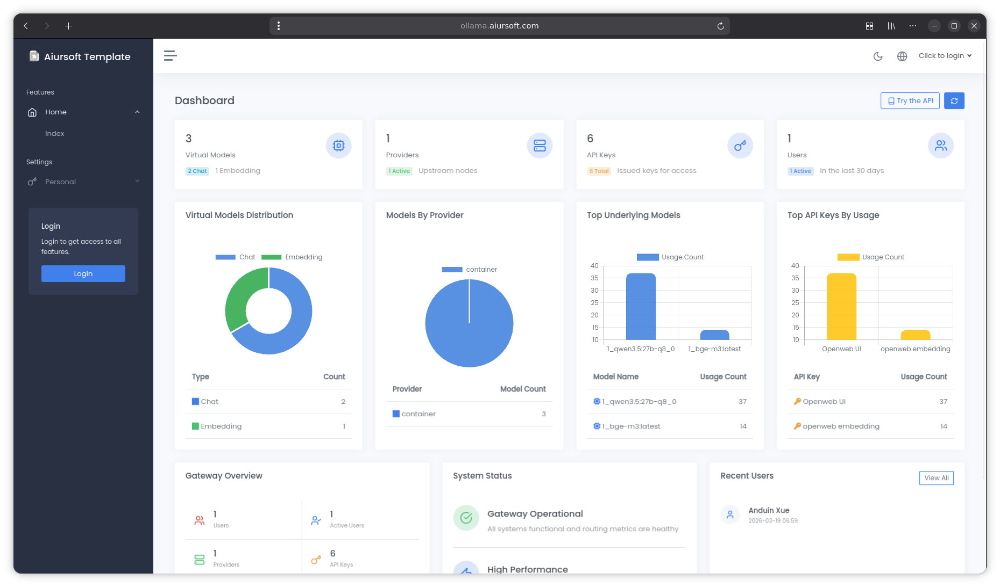

# Aiursoft OllamaGateway

<a name="ollama-gateway"></a>

[](https://github.com/aiursoftweb/ollamaGateway/blob/master/LICENSE)
[](https://gitlab.aiursoft.com/aiursoft/ollamaGateway/-/pipelines)
[](https://gitlab.aiursoft.com/aiursoft/ollamaGateway/-/pipelines)
[](https://s360.aiursoft.com/SupplyChain?tab=projects&project=aiursoft%2Follamagateway&scope=baseline&ecosystem=all)
[](https://manhours.aiursoft.com/r/github.com/aiursoftweb/ollamaGateway.html)
[](https://ollama.aiursoft.com)
[](https://hub.docker.com/r/aiursoft/ollamagateway)

Ollama Gateway: Supercharge your native Ollama with enterprise-grade API authentication, request auditing, rate limiting, and virtual model management—your secure, private AI gateway.



Default user name is `admin@default.com` and default password is `Admin@123456!`.

## Overview

### What is OllamaGateway?

<a name="why-ollamagateway"></a>

Native Ollama is great for personal use, but it lacks the enterprise features required for team collaboration and production deployment. OllamaGateway fills those gaps without changing your workflow.

| Feature | Native Ollama | OllamaGateway |
|---|:---:|:---:|
| Model Hosting & Inference | ✅ | ✅ |
| Multimodal | ✅ | ✅ |
| MCP | ✅ | ✅ |
| Function Call | ✅ | ✅ |
| Streaming | ✅ | ✅ |
| OpenAI API Translation | ⚠️ Partial[^1] | ✅ |
| Anthropic API Translation | ✅ | ✅ |
| API Authentication (Bearer Token) | ❌ | ✅ |
| Multiple API Keys Management | ❌ | ✅ |
| Request & Response Auditing | ❌ | ✅ |
| API Rate Limiting | ❌ | ✅ |
| Virtual Model Overrides | ❌ | ✅ |
| Multi-backend Support | ❌ | ✅ |
| Load Balancing | ❌ | ✅ |
| Tiered Fallback | ❌ | ✅ |
| Default Model Support | ❌ | ✅ |
| Model Keep-alive (Ping) | ❌ | ✅ |
| Admin Management GUI | ❌ | ✅ |
| Chat/Embedding Segregation | ❌ | ✅ |

[^1]: Native Ollama partially supports OpenAI API. It lacks advanced system prompt mapping, parameter overriding, and role translation.

## Try

Try a running OllamaGateway [here](https://ollama.aiursoft.com).

## Install with Docker

Run the installer with the desired port (omit it to choose an available port):

```bash
curl -fsSL https://raw.githubusercontent.com/aiursoftweb/ollamagateway/master/install.sh | sudo bash -s -- 8080
```

Installation starts after three seconds; press Ctrl+C to cancel. Then open `http://localhost:8080`.

## Run manually

Requirements about how to run

1. Install [.NET 10 SDK](http://dot.net/) and [Node.js](https://nodejs.org/).
2. The .NET build automatically runs `npm ci` and `npm run build` to prepare the frontend assets. Node.js and npm must be available when building from source.
3. Execute `dotnet run --project src/Aiursoft.OllamaGateway/Aiursoft.OllamaGateway.csproj -- --urls http://localhost:5000` to run the app.
4. Use your browser to view [http://localhost:5000](http://localhost:5000).

## Run in Microsoft Visual Studio

1. Open the `.sln` file in the project path.
2. Press `F5` to run the app.

## Run in Docker

First, install Docker [here](https://docs.docker.com/get-docker/).

Then run the following commands in a Linux shell:

```bash
image=aiursoft/ollamagateway
appName=ollamagateway
sudo docker pull $image
sudo docker run -d --name $appName --restart unless-stopped -p 5000:5000 -v /var/www/$appName:/data $image
```

That will start a web server at `http://localhost:5000` and you can test the app.

The docker image has the following context:

| Properties  | Value                           |
|-------------|---------------------------------|
| Image       | aiursoft/ollamagateway          |
| Ports       | 5000                            |
| Binary path | /app                            |
| Data path   | /data                           |
| Config path | /data/appsettings.json          |

## Usage

### Agent & Ecosystem Ready

OllamaGateway has been officially tested and is fully compatible with popular ecosystem tools including **Claude Code**, **Open-WebUI**, **Opencode**, and **Roocode**. Its robust API translation makes it the ideal choice for deploying autonomous AI agents.

#### Recommended Models for Agents

For the best experience with AI agents, we recommend the following models:
- `qwen3.6:27b-q8_0`
- `qwen3.6:35b-a3b-q4_K_M`

### Grafana Monitoring Dashboard

OllamaGateway logs every request to a ClickHouse database. A pre-built Grafana dashboard template is provided at [`docs/grafana-config.json`](./docs/grafana-config.json) to visualize traffic, latency, and usage in real time.

1. In Grafana, go to **Dashboards → Import**.
2. Upload `docs/grafana-config.json` or paste its contents.
3. When prompted, select your ClickHouse data source for the **grafana-clickhouse-datasource** input.
4. Click **Import**.

### Protocol translation

Ollama Gateway exposes four client-facing dialects:

- Ollama native (`/api/chat`)
- OpenAI Chat Completions (`/v1/chat/completions`)
- OpenAI Responses (`/v1/responses`)
- Anthropic Messages (`/v1/messages`)

Requests are decoded into a protocol-neutral representation and then encoded for the selected physical backend. Responses take the reverse path. Each physical-model backend records its actual protocol independently from its provider, so one OpenAI-compatible provider can host both Chat Completions and Responses backends.

When the client and physical backend use the same dialect, the gateway takes a transparent fast path: it preserves unknown request fields, response items, and stream events while changing only gateway-owned fields such as the model name. Cross-dialect calls use the neutral representation.

Responses supports text, image, custom-function, structured-output, reasoning, and streaming translation. Native Responses tools and stateful controls (`previous_response_id`, Conversations, stored responses, and background mode) are forwarded only to Responses-capable backends. If no native Responses route is available, those features return an explicit `unsupported_feature` error instead of being silently ignored.

### Legacy parameter behavior by provider and API format

The table below documents the pre-Responses Chat Completions, Ollama, and Anthropic parameter mappings:

- **Paths ① and ③** enter via `/v1/chat/completions` and are handled by `OpenAIController`.
- **Paths ② and ④** enter via `/api/chat` and are handled by `ProxyController`.
- **Paths ⑤ and ⑥** enter via `/v1/messages` and are handled by `AnthropicController`.
- OpenAI Responses enters via `/v1/responses` and is handled by `OpenAIResponsesController`; its mappings are described above rather than added to this legacy matrix.

> **"DB override"** means a hard assignment (`=`), not a null-coalescing assignment (`??=`). When the virtual model has a value configured in the database, the client-supplied value is **always discarded**, regardless of what the client sent.

| Parameter | ① OpenAI provider<br>+ OpenAI API | ② OpenAI provider<br>+ Ollama API | ③ Ollama provider<br>+ OpenAI API | ④ Ollama provider<br>+ Ollama API | ⑤ OpenAI provider<br>+ Anthropic API | ⑥ Ollama provider<br>+ Anthropic API |
|-----------|-----------------------------------|-----------------------------------|-----------------------------------|-----------------------------------|--------------------------------------|--------------------------------------|
| Temperature | ✅ Client value arrives<br>✏️ DB hard-overrides if set<br>➡️ Forwarded as `"temperature"` (passthrough) | ✅ Client value arrives<br>✏️ DB hard-overrides if set<br>➡️ Forwarded as `"temperature"` | ✅ Client value arrives<br>✏️ DB hard-overrides if set<br>➡️ Forwarded as `options.temperature` to Ollama | ✅ Client value arrives<br>✏️ DB hard-overrides if set<br>➡️ Forwarded as `options.temperature` to Ollama | ✅ Client value arrives<br>✏️ DB hard-overrides if set<br>➡️ Forwarded as `"temperature"` | ✅ Client value arrives<br>✏️ DB hard-overrides if set<br>➡️ Forwarded as `options.temperature` |
| Top P | ✅ Client value arrives<br>✏️ DB hard-overrides if set<br>➡️ Forwarded as `"top_p"` (passthrough) | ✅ Client value arrives<br>✏️ DB hard-overrides if set<br>➡️ Forwarded as `"top_p"` | ✅ Client value arrives<br>✏️ DB hard-overrides if set<br>➡️ Forwarded as `options.top_p` to Ollama | ✅ Client value arrives<br>✏️ DB hard-overrides if set<br>➡️ Forwarded as `options.top_p` to Ollama | ✅ Client value arrives<br>✏️ DB hard-overrides if set<br>➡️ Forwarded as `"top_p"` | ✅ Client value arrives<br>✏️ DB hard-overrides if set<br>➡️ Forwarded as `options.top_p` |
| Top K | ❌ Always discarded<br>🚫 OpenAI does not support it<br>➖ DB does not inject it | ❌ Always discarded<br>✏️ DB injects into `options` but the field is dropped before the OpenAI request is sent | 🚫 Client cannot pass it (no such field in OpenAI API)<br>✏️ DB injects if set<br>➡️ Forwarded as `options.top_k` to Ollama | ✅ Client value arrives<br>✏️ DB hard-overrides if set<br>➡️ Forwarded as `options.top_k` to Ollama | ❌ Always discarded<br>🚫 OpenAI does not support it | 🚫 Client cannot pass it<br>✏️ DB injects if set<br>➡️ Forwarded as `options.top_k` |
| Num Ctx | ❌ Always discarded<br>🚫 OpenAI does not support it<br>➖ DB does not inject it | ❌ Always discarded<br>✏️ DB injects into `options` but the field is dropped before the OpenAI request is sent | 🚫 Client cannot pass it (no such field in OpenAI API)<br>✏️ DB injects if set<br>➡️ Forwarded as `options.num_ctx` to Ollama | ✅ Client value arrives<br>✏️ DB hard-overrides if set<br>➡️ Forwarded as `options.num_ctx` to Ollama | ❌ Always discarded<br>🚫 OpenAI does not support it | 🚫 Client cannot pass it<br>✏️ DB injects if set<br>➡️ Forwarded as `options.num_ctx` |
| Thinking | Client setting is preserved; selected backend may override switch and effort | Client setting is preserved or translated; selected backend may override switch and effort | Client effort is translated; selected backend may force `think` on/off | Client `think` is preserved; selected backend may force on/off | Translated client setting; selected backend may override switch and effort | Translated client setting; selected backend may force `think` on/off |

| Images / Multimodal | ✅ Multimodal content array passes through as-is<br>➡️ Direct passthrough to OpenAI backend | ✅ Ollama images converted<br>➡️ `images[]` → `content[text+image_url]` | ✅ OpenAI content array extracted<br>➡️ `content[image_url]` → `images[]` | ✅ Images array passes through<br>➡️ Direct passthrough to Ollama | ❌ Not yet translated<br>🚫 Anthropic image blocks dropped | ❌ Not yet translated<br>🚫 Anthropic image blocks dropped |

### Backend thinking overrides

Thinking overrides are configured per model backend. Ollama-native backends offer **Do not override** (default), **Force on**, and **Force off**. No override preserves the client's boolean or named `think` level; when absent, the upstream default applies. Cross-protocol requests translate the client control to the target protocol. OpenAI Chat Completions and Responses backends also offer an independent **Do not override / Force on / Force off** switch, sent as `chat_template_kwargs.enable_thinking`. This is a vLLM-style extension: leave the switch unconfigured for providers that do not support it, such as ordinary OpenAI backends. The adjacent question-mark buttons explain forwarding, field mappings, provider/model differences, and conflicting settings. These backends also offer a free-text reasoning effort override (for example, `medium`, `high`, or `xhigh`). Leave it empty to preserve the client setting or the upstream default when absent. The model must support the value you enter; Gateway does not map effort names to other levels. A configured depth also overrides an existing `chat_template_kwargs.reasoning_effort` so a client template argument cannot shadow it. The switch and depth are independent; for vLLM/Qwen3.8, for example, force the switch on and use `xhigh` when both should be fixed. Existing backends inherit the new switch without changing their depth settings.

Overrides apply to **same-dialect direct forwarding and cross-dialect translation**. After selecting a backend, Gateway applies that backend's configured value to the outgoing request: `reasoning_effort` for Chat Completions, `reasoning.effort` for Responses, or boolean `think` for Ollama. Every fallback attempt uses its own backend configuration; a failed attempt cannot leak its override into the next attempt.

On upgrade, existing virtual-model thinking settings move to each Ollama-native backend. OpenAI backends stop receiving the old virtual-model `chat_template_kwargs.enable_thinking` injection; clients that need it can supply it themselves or administrators can configure the new per-backend switch. A downgrade can restore a model-wide setting only when all of its backends have the same explicit override.

## Configuration

The application defaults are defined in [`src/Aiursoft.OllamaGateway/appsettings.json`](src/Aiursoft.OllamaGateway/appsettings.json). The Docker image initializes `/data/appsettings.json` on its first start and keeps it for later starts; persist `/data`. Override nested values with double-underscore environment variables, such as `Logging__LogLevel__Default`.

```jsonc
{
  "ConnectionStrings": {
    "AllowCache": "True",

    "DbType": "Sqlite",
    "DefaultConnection": "DataSource=app.db;Cache=Shared"

    // sudo docker run -d --name db -e MYSQL_RANDOM_ROOT_PASSWORD=true -e MYSQL_DATABASE=ollamagateway -e MYSQL_USER=ollamagateway -e MYSQL_PASSWORD=ollamagateway_password -p 3306:3306 hub.aiursoft.com/mysql
    //"DbType": "MySql",
    //"DefaultConnection": "Server=localhost;Database=ollamagateway;Uid=ollamagateway;Pwd=ollamagateway_password;"
  },
  "Storage": {
    "Path": "/tmp/data",
    "PublicOrigin": "",
    "RequireDedicatedInlineOrigin": false,
    "AllowArbitraryInlineOnDedicatedOrigin": false,
    "SafeInlineMediaExtensions": ["svg"],
    "SafeInlineSvgSubfolders": ["project-logo"],
    "UploadPolicy": {
      "RequireAuthenticatedUser": false,
      "ReplaceSpacesWithHyphens": false
    }
  },
  "AppSettings": {
    "AuthProvider": "Local", // OIDC or Local
    "DefaultRole": "",
    "PersistsSignIn": false,
    "OIDC": {
      // https://auth.aiursoft.com/application/o/ollamagateway
      "Authority": "https://auth.aiursoft.com/application/o/ollamagateway",
      "ClientId": "",
      "ClientSecret": "",
      "RolePropertyName": "groups",
      "UsernamePropertyName": "preferred_username",
      "UserDisplayNamePropertyName": "name",
      "EmailPropertyName": "email",
      "UserIdentityPropertyName": "sub"
    },
    "Local": {
      "AllowRegister": true,
      "AllowWeakPassword": true
    }
  },
  "GlobalSettings": {
    // You can initialize or override global settings here.
    // "Allow_User_Adjust_Nickname": "True",
    // "BrandName": "Aiursoft",
    // "BrandHomeUrl": "https://www.aiursoft.com/",
    // "Icp": "",
    // "ProjectName": "Ollama Gateway"
  },
  "Logging": {
    "LogLevel": {
      "Default": "Information",
      "Microsoft.AspNetCore": "Warning"
    },
    "Clickhouse": {
      "Enabled": false,
      "ConnectionString": "Host=localhost;Protocol=http;Port=8123;User=default;Password=;Database=AspNetCoreLogs",
      "TableName": "OllamaGatewayLogs"
    }
  },
  "Clickhouse": {
    "Enabled": false,
    "ConnectionString": "Host=localhost;Protocol=http;Port=8123;User=default;Password=;Database=OllamaGatewayAudit",
    "TableName": "RequestLogs"
  },
  "AllowedHosts": "*"
}
```

### Shared settings

- `ConnectionStrings` selects the database provider and connection. Prepare the external database before choosing MySQL; keep the SQLite file persistent when using SQLite.
- `Storage` configures local application files. Keep the storage directory persistent and use the documented hostname and upload policies for shared downloads.
- `AppSettings` controls authentication and account synchronization. Choose local accounts or configure the OIDC authority, client and `/signin-oidc` callback; use environment variables for credentials.
- Uncommented `GlobalSettings` entries override the database-backed administration settings. Leave entries commented to use the stored values or application defaults.
- `Logging:LogLevel` controls application and framework verbosity. Configure the optional ClickHouse exporter only when its server and credentials are ready.
- `AllowedHosts` is the ASP.NET Core Host-header allowlist, not a CORS setting.

## How to contribute

There are many ways to contribute to the project: logging bugs, submitting pull requests, reporting issues, and creating suggestions.

Even if you with push rights on the repository, you should create a personal fork and create feature branches there when you need them. This keeps the main repository clean and your workflow cruft out of sight.

We're also interested in your feedback on the future of this project. You can submit a suggestion or feature request through the issue tracker. To make this process more effective, we're asking that these include more information to help define them more clearly.

## License

Licensed under the [MIT License](LICENSE).
